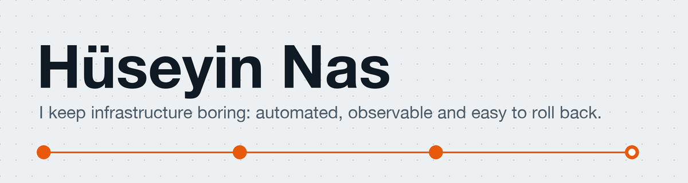

<picture>
  <source media="(prefers-color-scheme: dark)" srcset="banner-dark.png">
  
</picture>

**DevOps Engineer at Ayti.Tech.** CI/CD, cloud operations on AWS and GCP, and zero-trust access for production e-commerce workloads. Based in Kocaeli, Türkiye, open to remote roles.

| | |
|---|---|
| **Working on** | CI/CD pipelines (GitHub Actions, Jenkins), AWS and GCP operations, Cloudflare Zero Trust |
| **Learning** | Terraform and Kubernetes, hands-on |
| **Background** | On-prem virtualization (Xen, VMware) and private cloud build-out |

**Projects**

- [huseyinnas.github.io](https://github.com/huseyinnas/huseyinnas.github.io): my portfolio, plain HTML and CSS, with a request that travels to the page
- [monitoring](https://github.com/huseyinnas/monitoring): Bash scripts for monitoring and reporting on Linux systems

[Portfolio](https://huseyinnas.github.io) · [LinkedIn](https://www.linkedin.com/in/huseyinnas/)
